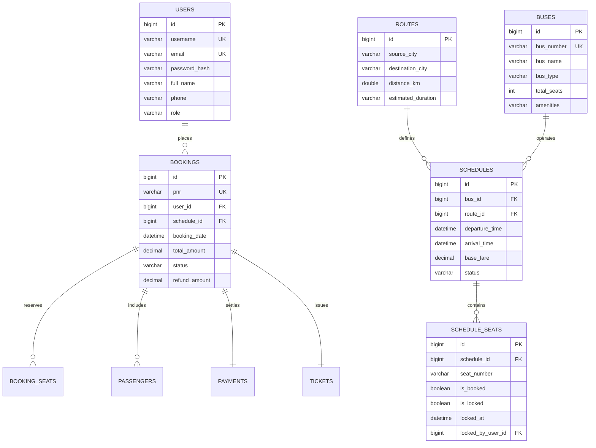

# 🚌 Bus Reservation System (BRS)

An enterprise-grade, full-stack **Bus Reservation System** built with **Java 17**, featuring a **Spring Boot 3 REST API Backend**, a **MySQL Database**, **Spring Security with JWT**, **Razorpay Payment Gateway Integration**, **Automated PDF Ticket & QR Code Generation**, and a **Modern Desktop Swing Client** styled with **FlatLaf**.

---

## 📑 Table of Contents
1. [Project Overview](#-project-overview)
2. [Technology Stack](#-technology-stack)
3. [System Architecture](#-system-architecture)
4. [Step-by-Step Working & User Journey](#-step-by-step-working--user-journey)
   - [1. Bus Search & Route Validation](#1-bus-search--route-validation)
   - [2. Interactive Seat Selection & 10-Minute Seat Lock](#2-interactive-seat-selection--10-minute-seat-lock)
   - [3. Seamless Guest-to-User Authentication](#3-seamless-guest-to-user-authentication)
   - [4. Payment & Checkout (Razorpay Test / Mock Mode)](#4-payment--checkout-razorpay-test--mock-mode)
   - [5. E-Ticket Issuance, OpenPDF & ZXing QR Code](#5-e-ticket-issuance-openpdf--zxing-qr-code)
   - [6. My Bookings & Tiered Cancellation / Refund System](#6-my-bookings--tiered-cancellation--refund-system)
   - [7. Administrator Dashboard & Fleet Analytics](#7-administrator-dashboard--fleet-analytics)
5. [Database Architecture & Schema (MySQL)](#-database-architecture--schema-mysql)
6. [Prerequisites & System Requirements](#-prerequisites--system-requirements)
7. [Step-by-Step Setup & Installation Guide](#-step-by-step-setup--installation-guide)
   - [Step 1: Database Setup](#step-1-database-setup)
   - [Step 2: Start Spring Boot Backend](#step-2-start-spring-boot-backend)
   - [Step 3: Launch Desktop GUI Client](#step-3-launch-desktop-gui-client)
8. [Default Login Credentials](#-default-login-credentials)
9. [Key Design Highlights & Viva / Defense Talking Points](#-key-design-highlights--viva--defense-talking-points)
10. [Troubleshooting & FAQs](#-troubleshooting--faqs)

---

## 🌟 Project Overview

The **Bus Reservation System (BRS)** is designed to solve real-world challenges in public and private transit booking. It eliminates double-booking issues through temporary seat locking, delivers electronic tickets with machine-scannable QR codes, automates cancellation refunds based on departure proximity, and gives administrators complete visibility over fleet operations, seat occupancy, and revenue.

---

## 🛠️ Technology Stack

### Backend (`brs-backend`)
- **Language & Runtime:** Java 17 (LTS)
- **Framework:** Spring Boot 3.2.4
- **Security:** Spring Security 6 + JJWT (JSON Web Token 0.11.5)
- **Persistence:** Spring Data JPA + Hibernate 6
- **Database:** MySQL 8.0+
- **Document Generation:** OpenPDF 1.3.30 (E-ticket rendering)
- **Barcodes & QR Codes:** Google ZXing 3.5.2 (Base64 matrix generation)
- **Payment Gateway:** Razorpay Java SDK 1.4.3 (with test & mock fallback)
- **Utilities:** Lombok, Apache Commons Lang3

### Frontend Desktop Client (`brs-desktop`)
- **GUI Framework:** Java Swing (`javax.swing`)
- **Theme & Modern Look:** FlatLaf 3.4.1 (Clean, responsive macOS/Windows-style UI)
- **HTTP Client:** Square OkHttp 4.12.0
- **JSON Parser:** Jackson Databind 2.15.2
- **Vector Graphics:** Custom Java 2D vector icons with anti-aliasing (`RenderingHints.KEY_ANTIALIASING`)
- **Concurrency:** `SwingWorker` background tasks for zero UI freezing during API calls

---

## 📐 System Architecture

The project is structured as a Maven multi-module application:

```
d:/BRS Java/
├── pom.xml                               # Parent Maven POM
├── schema.sql                            # Relational Database Schema & Sample Seed Data
├── README.md                             # Project Documentation & Architecture Guide
│
├── brs-backend/                          # Spring Boot REST API Service (Port 8080)
│   ├── pom.xml
│   └── src/main/
│       ├── java/com/brs/
│       │   ├── BrsBackendApplication.java
│       │   ├── config/                   # SecurityConfig, CorsConfig, DataInitializer
│       │   ├── controller/               # REST Controllers (Auth, Bus, Schedule, Booking, Payment, Ticket, Admin)
│       │   ├── dto/                      # Request / Response DTOs
│       │   ├── entity/                   # JPA Entities (User, Bus, Route, Schedule, Seat, Booking, Payment, Ticket)
│       │   ├── repository/               # Spring Data JPA Repositories
│       │   ├── security/                 # JwtUtils, AuthTokenFilter, UserPrincipal
│       │   └── service/                  # Business Logic, Payment, OpenPDF & ZXing Service
│       └── resources/
│           └── application.yml           # Database credentials, JWT secrets, Razorpay mode
│
└── brs-desktop/                          # Java Swing Desktop Client
    ├── pom.xml
    └── src/main/java/com/brs/client/
        ├── BrsDesktopApp.java            # Main Desktop GUI Entry Point
        ├── api/
        │   └── ApiClient.java            # OkHttp REST Client (handles JWT headers & error handling)
        ├── model/                        # Client-side POJO Models (with Lombok & Builder support)
        └── ui/
            ├── UiUtils.java              # Design tokens, color palette, font typography
            ├── IconUtils.java            # High-resolution vector icon renderer
            ├── CalendarDatePickerDialog.java # Custom month-grid date picker with past-date disabling
            ├── MainFrame.java            # Primary application container with dynamic auth header
            ├── BusSearchPanel.java       # Route search, city selectors, live availability table
            ├── SeatSelectionDialog.java  # Visual bus seat grid, 10-minute lock timer & legend
            ├── PaymentDialog.java        # Razorpay checkout modal with active hold timer
            ├── BookingSuccessDialog.java # Success confirmation with QR code & PDF preview
            ├── MyBookingsPanel.java      # Passenger booking history, ticket viewer & cancellation
            ├── AdminDashboardPanel.java  # Admin KPIs, revenue metrics, bus & route management
            ├── LoginDialog.java          # Authentication dialog (User / Admin)
            └── RegisterDialog.java       # Self-registration dialog for new passengers
```

---

## 🔄 Step-by-Step Working & User Journey

### 1. Bus Search & Route Validation
- The passenger launches the application in **Guest Mode** (no initial login required to browse).
- **Source & Destination Selection:** Choose departure and destination cities.
  - *Validation Guard:* If the user selects the same city for both Source and Destination (e.g. *Jaipur to Jaipur*), the system instantly clears the results table, disables the "Search Buses" button, and displays an inline warning: `⚠ Invalid Route: Source and Destination cannot be the same city`.
- **Interactive Calendar Date Picker:** Clicking the calendar icon opens a visual month-grid picker. Past dates are automatically disabled to prevent invalid bookings.
- **Search Results:** Results display Bus Name, Bus Number, Type (AC Sleeper / Seater / Volvo), Departure City, Arrival City, Departure Time, Arrival Time, Available Seats counter, and Base Fare.

### 2. Interactive Seat Selection & 10-Minute Seat Lock
- Clicking **"Select Seats"** launches the graphical seat map layout.
- The seat map reflects the bus deck configuration (Driver steering wheel icon at front, 2x2 seat columns, aisle separation).
- **Seat States & Color Coding:**
  - 🟢 **Available (White / Light Green):** Clickable to select.
  - 🟦 **Selected (Primary Blue):** Selected by the current user.
  - 🟥 **Booked (Red / Disabled):** Permanently reserved by a confirmed booking.
  - 🟧 **Temporarily Locked (Orange / Disabled):** Currently locked by another passenger who is checking out.
- **Automatic 10-Minute Lock Timer:** As soon as seats are locked, a synchronized countdown timer (`MM:SS`) starts. If checkout is not completed within 10 minutes, the lock expires and the seats are automatically released back to the general pool.

### 3. Seamless Guest-to-User Authentication
- Guests can browse routes and pick seats freely.
- When clicking **"Proceed to Booking"**, if the user is not authenticated, a sign-in modal appears.
- **Auth State Synchronization:** Upon successful login:
  - The main application header instantly switches from **"Guest"** to **`username (Passenger)`** with a **"Sign Out"** button.
  - The seat selection session is preserved, and the workflow automatically advances directly into payment without making the user re-select their seats.

### 4. Payment & Checkout (Razorpay Test / Mock Mode)
- The [PaymentDialog](file:///d:/BRS%20Java/brs-desktop/src/main/java/com/brs/client/ui/PaymentDialog.java) displays a summary of the booking: Route, Bus Name, Selected Seat numbers, Fare Breakdown (Base Fare + GST), and Total Amount.
- Shows the active **Hold Timer** (`Hold: 09:45`) so the user knows how much time remains on their seat lock.
- **Payment Processing:**
  - In production mode, communicates with Razorpay API using order creation and HMAC-SHA256 signature verification.
  - In `mock-mode: true` (default for college viva and offline demos), simulates an instant successful transaction with a generated payment reference ID.

### 5. E-Ticket Issuance, OpenPDF & ZXing QR Code
- Once payment is verified, the backend creates a confirmed `Booking` record and generates a unique **PNR (Passenger Name Record)** (e.g. `PNR-BRS-7K9A2M`).
- **Electronic Boarding Pass:** OpenPDF compiles an official, styled PDF boarding pass including passenger names, bus operator details, seat assignments, departure date/time, and emergency instructions.
- **Embedded QR Code:** Google ZXing renders an embedded, scannable QR Code containing the encrypted PNR and validation URL for bus conductors to scan at the gate.
- The user is presented with a **Booking Success Dialog** showing the QR code, with instant one-click buttons to **"Open PDF Ticket"** or **"Save to Disk"**.

### 6. My Bookings & Tiered Cancellation / Refund System
- Passengers can click the **"My Bookings"** tab to view their full reservation history.
- Each booking card shows the PNR, Travel Date, Route, Status (`CONFIRMED`, `CANCELLED`), and Action Buttons:
  - **View Ticket:** Opens the QR Code and digital boarding pass.
  - **Download PDF:** Exports the high-resolution PDF ticket.
  - **Cancel Booking:** Triggers the automated refund engine.
- **Tiered Cancellation & Refund Policy:**
  - **> 24 hours before departure:** **90% refund** (10% cancellation fee).
  - **12 to 24 hours before departure:** **70% refund** (30% cancellation fee).
  - **4 to 12 hours before departure:** **50% refund** (50% cancellation fee).
  - **< 4 hours before departure:** **0% refund** (Non-refundable).
- When cancelled, the reserved seats are instantly freed in `schedule_seats` and restored to the available pool.

### 7. Administrator Dashboard & Fleet Analytics
- Signing in with an administrator account (`admin` / `Admin@123`) activates the **Admin Dashboard** tab.
- **Executive KPIs:**
  - Total Fleet Revenue (₹)
  - Total Bookings count
  - Total Active Buses
  - Total Routes serviced
- **Fleet & Route Management:**
  - Add new buses (Bus Number, Operator Name, Bus Type, Total Capacity, Amenities).
  - Add new inter-city routes (Source City, Destination City, Distance in km, Duration).
  - Dispatch new schedules (Assign bus to route, set departure date/time, arrival time, base fare).
  - Master Booking Logs with refund tracking and passenger search.

---

## 🗄️ Database Architecture & Schema (MySQL)

The relational schema is defined in [schema.sql](file:///d:/BRS%20Java/schema.sql) and consists of 10 tables:



---

## 💻 Prerequisites & System Requirements

Before running the application, make sure you have:
1. **Java Development Kit (JDK):** Version 17 or higher (`java -version`).
2. **Maven:** Maven 3.8+ (or use the included Maven wrapper `mvnw` / `mvnw.cmd`).
3. **MySQL Server:** Version 8.0 or higher running on port `3306`.
4. **Operating System:** Windows, macOS, or Linux.

---

## 🚀 Step-by-Step Setup & Installation Guide

### Step 1: Database Setup
1. Start your local MySQL service.
2. Open MySQL Workbench or your terminal and execute:
   ```sql
   CREATE DATABASE IF NOT EXISTS brs_db;
   USE brs_db;
   SOURCE d:/BRS Java/schema.sql;
   ```
3. Verify that the MySQL user and password in `brs-backend/src/main/resources/application.yml` match your MySQL setup:
   ```yaml
   spring:
     datasource:
       url: jdbc:mysql://localhost:3306/brs_db?useSSL=false&serverTimezone=UTC&allowPublicKeyRetrieval=true
       username: root
       password: root   # <-- Update this to your local MySQL root password if different
   ```

---

### Step 2: Start Spring Boot Backend
Open a terminal in the root directory `d:/BRS Java`:

- **Windows (PowerShell / Command Prompt):**
  ```powershell
  .\mvnw.cmd spring-boot:run -pl brs-backend
  ```
- **macOS / Linux:**
  ```bash
  ./mvnw spring-boot:run -pl brs-backend
  ```

* Backend will start on: **`http://localhost:8080`**
* On first launch, the `DataInitializer` class automatically verifies and seeds default routes (Delhi, Jaipur, Mumbai, Pune, Bangalore, Hyderabad), buses, and upcoming schedules.

---

### Step 3: Launch Desktop GUI Client
Open a second terminal in `d:/BRS Java`:

- **Windows (PowerShell / Command Prompt):**
  ```powershell
  .\mvnw.cmd compile exec:java -pl brs-desktop -Dexec.mainClass="com.brs.client.BrsDesktopApp"
  ```
- **macOS / Linux:**
  ```bash
  ./mvnw compile exec:java -pl brs-desktop -Dexec.mainClass="com.brs.client.BrsDesktopApp"
  ```

---

## 🔑 Default Login Credentials

| Role | Username | Password | Capabilities |
| :--- | :--- | :--- | :--- |
| **System Administrator** | `admin` | `Admin@123` | Access Admin Dashboard, Revenue Analytics, Add/Manage Buses, Routes, and Schedules |
| **Test Passenger** | `user` | `User@123` | Search buses, Lock seats, Make bookings, View QR & PDF tickets, Cancel bookings |
| **New Passenger** | *(Self Register)* | *(Min 6 chars)* | Click **"Sign In"** -> **"Create Account"** directly in the desktop app |

---

## 💡 Key Design Highlights & Viva / Defense Talking Points

1. **Concurrency & Seat Locking Algorithm:**
   - Prevents race conditions and double bookings. When a passenger selects seats, they are placed in a 10-minute hold state (`is_locked = true` with a timestamp in `schedule_seats`). If another user views the bus during this window, the seat appears orange and disabled. A background task auto-releases expired locks.
2. **Dynamic Vector Icons Without External Assets:**
   - All icons (Location pins, Bus steering wheel, Shield lock, Calendar, Logout, Seats) are programmatically drawn in [IconUtils.java](file:///d:/BRS%20Java/brs-desktop/src/main/java/com/brs/client/ui/IconUtils.java) using Java 2D Graphics with anti-aliasing. This guarantees crisp rendering on 4K/Retina displays with zero missing image file errors.
3. **Stateless JWT Security Architecture:**
   - REST endpoints use JSON Web Tokens (HMAC-SHA256). The desktop client attaches the `Authorization: Bearer <token>` header to all protected endpoints via an OkHttp interceptor.
4. **OpenPDF & ZXing Integration:**
   - Demonstrates enterprise document generation: high-resolution vector PDF boarding pass with embedded scannable QR Code containing the passenger PNR and gate security token.
5. **Robust Offline / Viva Presentation Mode:**
   - Includes full Razorpay API support for live deployments, alongside a built-in mock mode (`app.razorpay.mock-mode: true`) enabling seamless, reliable offline demonstrations during college evaluations without requiring live Wi-Fi or active merchant credentials.

---

## ❓ Troubleshooting & FAQs

- **Q: Backend fails to connect to MySQL (`Access denied for user 'root'@'localhost'`)**
  - **A:** Open `brs-backend/src/main/resources/application.yml` and adjust `spring.datasource.password` to match your local MySQL root password.
- **Q: Port 8080 is already in use (`Port 8080 was already in use`)**
  - **A:** Stop the existing process running on port 8080, or change `server.port: 8081` in `application.yml` and update `BASE_URL` in [ApiClient.java](file:///d:/BRS%20Java/brs-desktop/src/main/java/com/brs/client/api/ApiClient.java).
- **Q: What happens if a passenger leaves during payment?**
  - **A:** The 10-minute lock countdown runs on both client and server. If the timer expires or the dialog is closed without completing payment, the backend releases the hold, making the seats available for other travelers.
- **Q: Where are downloaded PDF tickets stored?**
  - **A:** Tickets downloaded via the desktop app are saved in the `d:/BRS Java/generated_tickets/` directory or to your selected desktop download folder.
